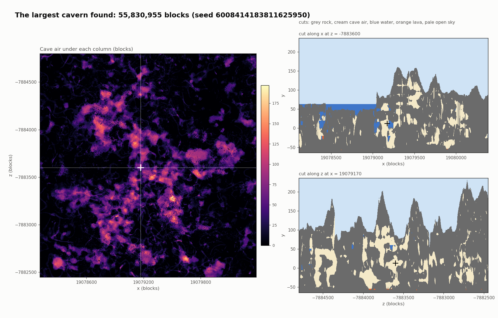
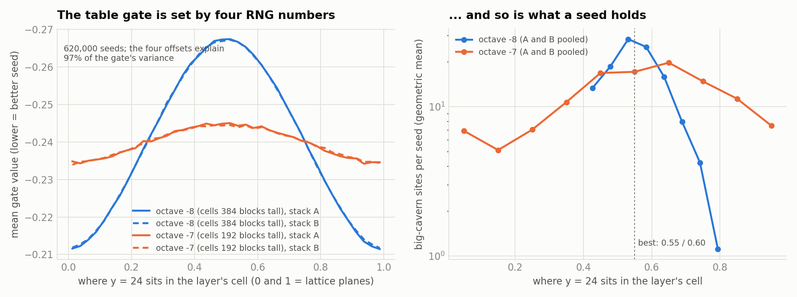
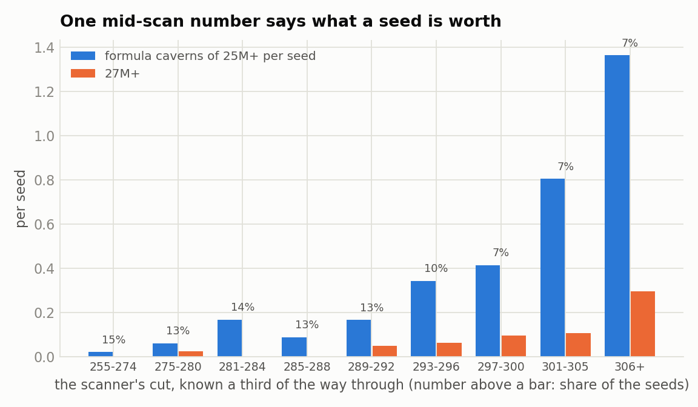
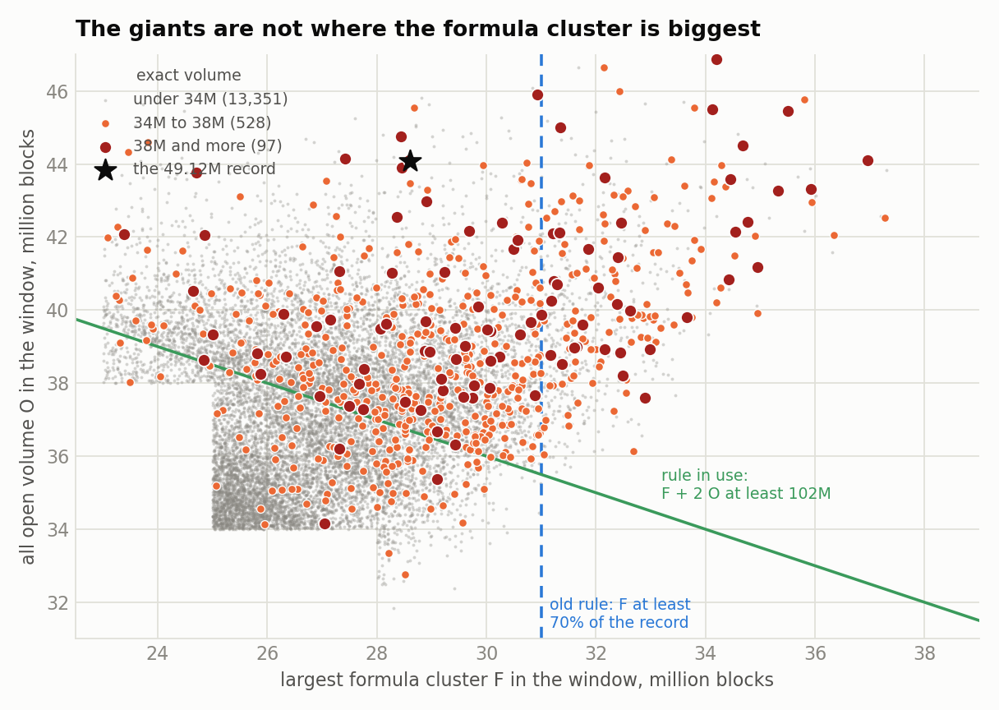
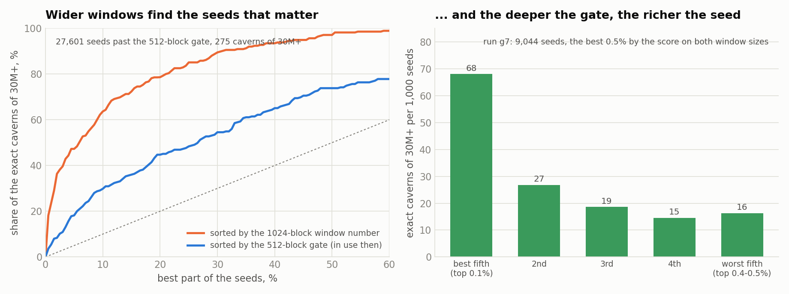
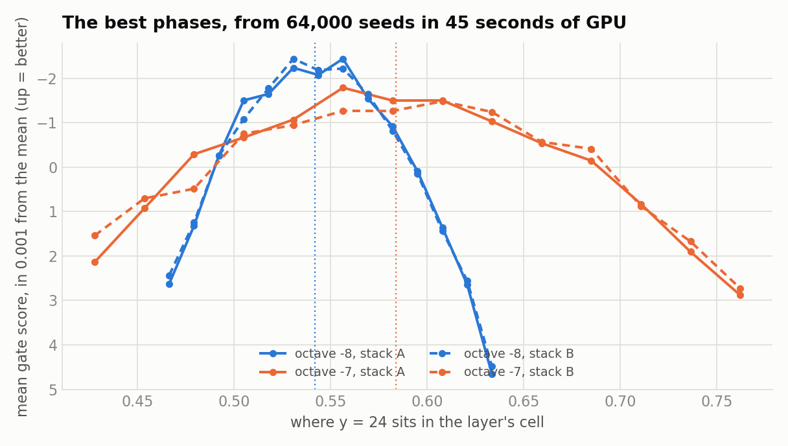
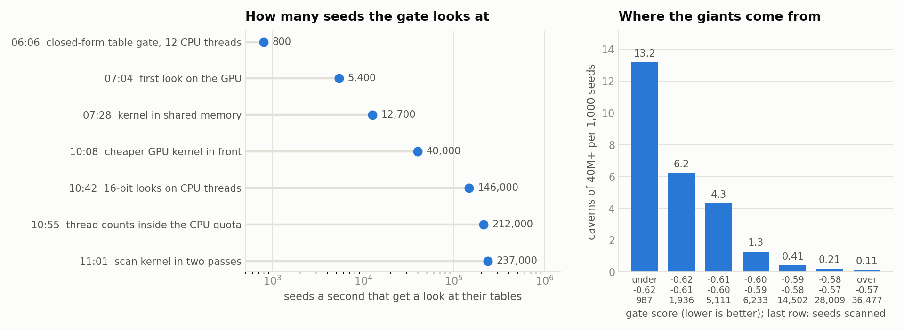
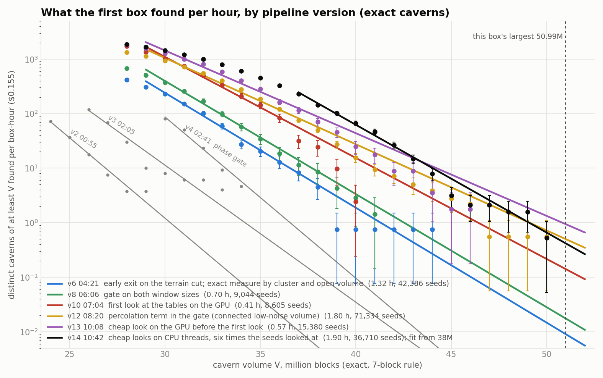

# The largest cave by volume: 54.6 million blocks

The task: find the largest cave in Minecraft 26.3 by volume, with a measure worth optimising and a search fast
enough to push it. The best cave so far is in seed **208969807933184** at `/tp -14756350 24 -17860759`:
**54,581,532 blocks** of connected cavern, 1,505 by 2,173 blocks across and 243 tall, checked block for block
against the game's own terrain code. The claimed record at the start was about 24M. Two rented boxes did it,
one after the other: an EPYC with an RTX A2000 ($0.16 an hour, $2.00 in all) and an EPYC with an RTX 4080
Super ($0.30 an hour, $1.50). In its first four hours the search found no cave of 40M+; at the end it found
two a minute. Times are UTC, 5 October 2026.

---

## 1. The measure

A cave here is a **cavern**: underground air (air with something solid above it, no water or lava) within 3
blocks of a connected set of *core* blocks, a core block being the centre of a 7×7×7 cube of underground air.
Two chambers count as one cavern only if a passage at least 7 blocks wide joins them, so thin tunnels do not chain
everything into one. Only the noise terrain and its aquifers count (no carvers, features or structures), which
is what the world generator fixes before anything else and what can be computed from the seed alone.

Everything is exact in the end: `native/cavemeasure` is a C++ port of the game's density function and aquifer
that floods the cavern on 320-bit columns, and the game's jar itself (`measure.sh`) confirmed each record with
the same volume and bounding box.

## 2. The search, stage by stage

A cheese cave appears where the `cave_cheese` noise is low. That noise is two stacks of Perlin layers, A and
B, at frequencies in the ratio 337:331, and each stack repeats every 65,536 blocks (64,364 for B). So a low
spot of A and a low spot of B meet at two or three places per axis in the world, which the Chinese remainder
theorem gives directly: nobody has to walk the world to find them. That is the **pair trick**, and every later
stage is a way of asking "which seeds, and which pairs, are worth the next stage?" more cheaply.

| stage | what it decides | where | cost |
|---|---|---|---|
| phase scan | are the y offsets of the four lowest cheese layers where the noise swings hardest at cave height, and those of the 12 lowest terrain layers where terrain is tallest? (RNG steps only, no noise) | GPU | 100 billion seeds/s |
| coarse looks | the lowest 1,280-block window mean of each stack, from the permutation tables: octave -8 first, then both octaves, then in full | GPU, then CPU | 0.7 µs; then 60 µs and 400 µs for the few left |
| table gate, first look | window means on a 256-block grid and pair counts, for the 1.2% past the coarse looks | GPU | 7,000 seeds/s |
| table gate, full | the same on the full grid, and the connected low-noise volume (percolation term) | CPU | 30 ms |
| scanner | the 200,000 best pairs, the terrain at each of their places, clusters on fine tables | GPU tables, formula and terrain; CPU clusters | 1.1 s |
| formula | the cheese formula on a 16-block grid around the best sites: largest cluster F and open volume O | GPU samples, CPU clusters | 5 ms a site |
| exact measure | the real cavern, block by block | GPU densities, CPU blocks and flood | 3 to 6 s a cavern |

(Costs on the second box. About one seed in four billion scanned reaches the scanner.)

## 3. The ideas, in the order they came

**Phases from the RNG (02:41).** A Perlin layer is weakest on its lattice planes and strongest half way between
them. The two lowest cheese octaves have cells 384 and 192 blocks tall, so where their planes fall in y decides
how hard the noise can swing where caves live, and that is one random number per layer. Four numbers predict
the table gate of a seed with r = 0.986. The same holds for the terrain layers. This was worth a factor 8.

**The table gate without noise samples (03:35).** The mean of a Perlin layer over a box is a closed form in the
gradients at the lattice corners, so the window means come straight from the permutation tables: 8 ms a seed
instead of 90.

**Terrain first, and stop early (04:21).** The scanner looks at the terrain above every place of every pair
before anything expensive, and one number a third of the way through (how many open points the 1,400th best
place has under its surface) says what the seed is worth. Seeds under a threshold stop there.

**The exact measure was looking in the wrong place (05:24).** The giants are 1,400 to 2,400 blocks long, longer
than the formula's 1,536-block window, and they are often several formula clusters that join in the real
terrain. Measuring only the sites with the biggest cluster caught 2 of the 5 known caves over 38M. Measuring by
cluster *and* open volume tripled the giants found; re-measuring sites already on disk turned up a 40.7M cave
that had been skipped.

**Wider windows in the gate (05:40, 06:06).** Since the giants are long, the seed gate should average the noise
over more than 512 blocks. Windows of 1,280 blocks predict a seed's big caverns far better, and the 512-block
number still counts beside it, more so the bigger the cavern. The score in use is the sum of both and the
terrain score.

**The GPU (06:48, 07:04).** The box's GPU had been idle. The phase scan is pure 64-bit arithmetic: 18 billion
seeds a second on the card against 0.1 billion per CPU thread. The table gate went there too, as a first look
on a coarse grid that follows the full score with r = 0.983: one block of 256 threads per seed, with every
intermediate in shared memory (the first version kept them in global memory and was no faster than the CPU).
The gate now looks at 13,000 seeds a second where twelve CPU threads managed 600, and keeps the best 0.07%
instead of the best 0.5%. The two GPU steps together were worth a factor 2.5 in caves of 30M+ per hour and
3.5 at 36M+.

The GPU also made measurements cheap that had been guesses. In 45 seconds it gave the score of 64,000 seeds
over phase windows three times as wide, which moved the phase centres from 0.550 and 0.595 to 0.542 and 0.584
and widened the windows to fit the card's time split.

**Percolation (08:20).** The biggest caverns look like percolation clusters: many blobs joined into one
sponge, and that is what they are. A giant forms where the *smooth* part of the noise (the two lowest octaves,
both stacks added) stays under a critical level over a connected region about 1.2 km across, whatever its
shape; inside such a region nearly all the open space hangs together. A complete search over all 65,536
offsets between the two stacks for such regions, with the terrain at every world place each offset produces,
ranks the 49.1M record as the **number-one place of its seed**; over 40 seeds with known giants a third of the
giants are their seed's best place, two thirds are in its best 10 and 96% in its best 150.

That search found no giant the scanner had missed (of 43 top places that pass the exact rule, 38 had been
measured and the other 5 came out at 19 to 28M), so the scanner stays. The idea went into the gate as a
cheaper term (the connected volume over the best alignments of each stack's lowest spots, 5 ms a seed), which
sorts already-gated seeds better offline but changed nothing measurable live: the workers already take the
best seeds first, and what limits the search now is how many seeds the GPU can look at.

The complete version is the natural next gate. The value of a seed's best place separates the seeds that hold
a giant from the rest more sharply than anything else measured here: 0.95 or more for 88% of the giant seeds
and for 15% of other gated seeds. But the brute-force search takes 55 CPU-seconds a seed, and it only pays
when applied to ten times more seeds than the scanner sees now, which needs a sparse algorithm on a bigger GPU.

**Where the giants come from (10:00).** With 93,000 scanned seeds on record, the answer to "what limits the
largest caves?" was in the data: they come from the very top of the gate's list. The best band of the score
holds a hundred times more caverns of 40M+ per seed than the bulk of what the workers were scanning, and the
number of seeds falls by 10 for every 0.0225 of score. So the largest caves are a matter of how many seeds the
gate can look at, and most of the box was busy with seeds that almost never hold one.

**The cheap look on a CPU thread (10:42).** The GPU's table kernel was the limit at 12,700 seeds a second, and
a cheaper kernel in front of it (octave -8 alone, coarse windows) got 40,000. Then the same look was written
for a CPU thread. Two things make it small. A wide window's mean is carried by the y components of the lattice
gradients (the other two only count at the window's edges), and those are -1, 0 or 1 times a weight, so the
whole look fits 16-bit integers: a byte shuffle turns 32 table entries into gradients at once. It takes
18.5 µs a seed on one laptop thread, where the whole card had needed 10.5 µs, and it sorts seeds as well as
the full number. A second 16-bit look adds octave -7, the full two-octave number confirms, and 1.2% of the
seeds go on to the GPU, which is back to scanning.

**The CPU quota (10:55).** The container may use 61 threads, and gate plus workers were running a hundred.
Linux then freezes every thread of the container for part of each tenth of a second, the one that drives the
GPU too, so the card sat idle a third of the time. With thread counts that fit the quota (27 for the gate, 35
single-threaded workers) the scan went from 10 to 14 billion seeds a second with nothing else changed. A scan
kernel that tests the first layer for a whole piece of seeds before the other three added 18%: with all four
tests in one loop, a GPU warp ran nearly every step for every seed.

**Workers for the top only (10:50 to 11:13).** With six times more top seeds arriving, the workers were
trimmed for them: the exact measure only for sites with F + 2 O of 107M or more (30% of the measurements),
fine tables for 1,250 places a seed instead of 5,000 (all 36 known caverns of 42M+ are found either way).
The first of these cost more than it looked when it was set: of the 64 caverns of 40M+ found before it, 48
pass it (and 12 of the 14 of 44M+), not the nine in ten a smaller sample had suggested. It bought twice the
top seeds per worker, which about evens out; 105M would have kept 54 of the 64. A refit on the 93,000 seeds also gave the terrain score three times
its old weight in the ranking.

**A bigger card, and the gate on it (17:20).** The second box has an RTX 4080 Super beside the same 61 CPU
threads. The terrain score went into the scan kernel (the host had been working it out for five million seeds a
second) and the first coarse look became a GPU kernel, 0.7 µs a seed. On the same 27 threads the gate looks
at 647,000 seeds a second where the CPU-look version manages 368,000.

**The scanner on the GPU (17:37 to 19:15).** With the gate that fast the workers were the limit, and their
time was 61% exact measure, 31% scanner, 8% formula stage. Four pieces of that moved to the card. One process
(`gpusrv`) holds the card for the workers and answers them over a socket:

- the scanner's terrain step: 1.5 million places a seed, up to 16 surface estimates each (Perlin octaves and
  the game's offset spline). A million places come back in 35 ms; the CPU needed over a second. Same decisions.
- the scanner's coarse tables and its formula step, and the formula stage's grids of open samples. Same sites.
- the exact measurer's density functions at the cell corners, which were 62% of a measurement. The generated
  density code is compiled for the card and gives the CPU's values bit for bit (410,000 compared, none
  different) at 0.3 µs a column; a CPU thread takes 130 µs.

A worker's time per seed went from 14.4 s to under 5, and the box scans 39,000 seeds an hour instead of 8,700.

What it took to make the kernels fast is worth keeping. The generated functions must stay calls: inlined, the
kernel was 10 MB and the driver took a quarter of an hour to load it. A launch is as slow as its slowest
thread, so the work is split into short threads (a column's cache first, then one thread per column and
level). Double precision runs at a sixty-fourth of single on this card, so the lattice arithmetic is done once
per column and once per level instead of per sample: five times faster. And hundreds of small requests are
gathered into one launch.

## 4. The rarity curve

Big caverns thin out exponentially. Every step above raised the curve, and two of them made it flatter: the
exact rule on two numbers and the wide gate (a factor 10 for every 3.4 million blocks in the early fits, 6.3
million with the percolation gate). The last version, in 1.9 hours, raised the curve by a factor 3 to 4 between 38M and 42M and by 2 at 44M. At
46M+ it found 4 caverns, as the version before it had in 1.8 hours: the far end is not shown to have moved.
The gate did its part (17 times more seeds in the best band of the score per hour, and per scanned seed
exactly as many of them inside the old filters as the old gate found); the stricter exact rule took some of
it back, and with four caverns on each side the rest is not measurable. It
measures a cavern only if F + 2 O reaches 107M, which leaves out most caverns under 38M, so its counts below
that are not comparable and its line is fitted from 38M up.

RATE_TABLE

## 5. What was tested and left alone

Gate depth between the best 0.2% and 0.5% on the CPU, the scanner's stop threshold over a wide range, other
height ranges for the window means, the formula at 8-block steps or in a 2,304-block window as a predictor,
tighter phase windows, pairs of neighbouring formula sites, and a scanner that goes straight to a seed's best
places all came out flat or worse. A real
block lattice in place of the formula, window-level count proxies and more formula octaves were dead ends.

On the second box: a quick estimate of a cavern from densities on a lattice twice as wide, to decide which
caverns get the exact measure (three times faster, but a cut on it keeps 8 of 13 caverns of 40M+: about 0.7
times the caverns per dollar); a cap on the gate's share of the card, and CPU threads taking the looks the
GPU does not get to (both gave the workers less than they cost in looks).

Late in the run, with the looks on the CPU: half the pairs in the scanner (loses 1 of 36 known giants for a
tenth of the worker time), a stricter cut before the full gate, other weights for the percolation volume
(flat between 0.09 and 0.22), wider phase and terrain filters (the seeds they add are worth three quarters of
the average and cost the same CPU), and more expensive hardware (nothing on offer beats this box per dollar
now that the looks run on CPU threads).

What is left is no longer tuning. The gate, the scan and the workers each sit on a flat optimum for this box:
the card is busy, the CPU quota is full, and every cut tested moves the rate by a few percent at most. The
next factor would come from the complete alignment search of section 3 as a second gate for the top seeds, or
simply from more boxes of the same kind.

An aside the data answered: none of the big caverns is free of deep dark (the top 20 have it in 14 to 52% of
their air), because deep dark sits under exactly the mountain terrain that giants need. The largest
deep-dark-free cavern among the measured ones is 17,724,200 blocks, seed 1382579, `/tp 26881896 1 -12313227`.

## 6. The top of the list

TOP_TABLE

## 7. Files

`gpuscan.cu`, `gpulook.cu`, `gputables.cu`, `seedgate12.cpp` (the gate), `cpuprelook.hpp` (the coarse looks),
`gpusrv.cpp` with `gputerrain.cu`, `gpupairs.cu`, `gpuformula.cu`, `native/gpudensity.cu` (the GPU's services for the
workers), `cavepairs5.cpp`, `formulacave5.cpp` (the scanner and formula stage that use them),
`analyticgate.hpp` (the closed-form window means),
`percgate.hpp` (the percolation term), `stats/alignplaces.cpp` (the complete alignment search),
`cavepairs3.cpp` (the scanner), `formulacave.cpp`, `native/cavemeasure.cpp` and `native/gamegen.hpp` (the
exact measure), `search3.py` (the driver), `measure.sh` (the game's own code), `stats/` (fits and probes),
`hits/` (every exact measurement), `docs/plots.py` (these figures).
