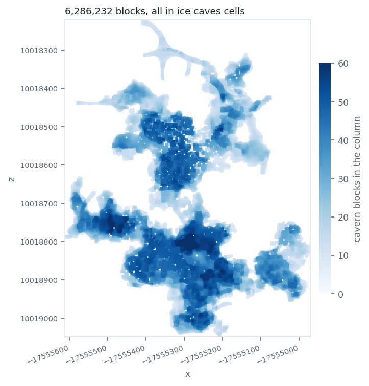
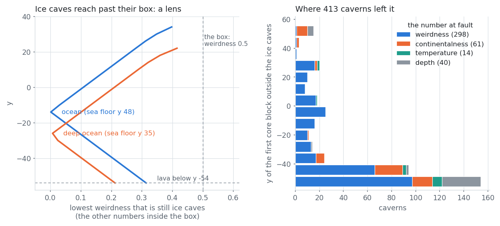
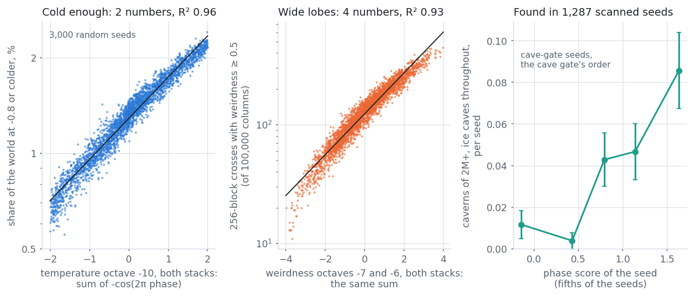
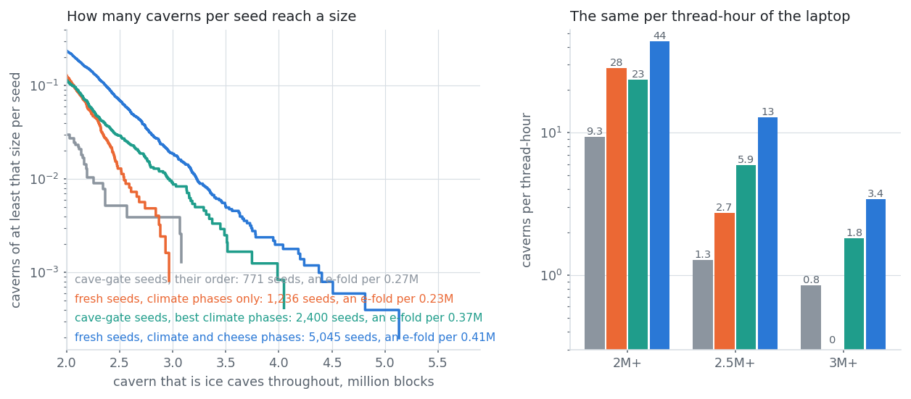
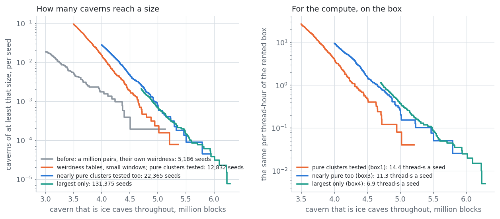

# The largest ice caves cavern: RECORD_M million blocks

Ice caves arrived in Minecraft 26.4-snapshot-3 on 6 October 2026. The task, the same day: find the largest cavern
in them, preferably one that is ice caves throughout. The best so far is in seed **RECORD_SEED** at
`/tp RECORD_TP`: **RECORD_BLOCKS blocks** of connected cavern, every one of them in an ice caves cell, confirmed on
the terrain the snapshot's own code generates and by its own biome source. The search ran on one 12-thread laptop and, for its last hours, also on a rented 32-thread machine whose graphics card does the seed gate ($1.45 of rent in all).

{width=58%}

---

## 1. What is measured

A cavern as in the cave search: underground air within 3 blocks of a connected core of 7×7×7 air cubes, noise terrain
and aquifers only. A block is in ice caves when its 4×4×4 biome cell is. Two categories:

- **ice caves throughout**: every block of the cavern;
- **ice caves volume**: the cavern's blocks in ice caves cells, whatever the rest is.

The snapshot's rule, read from its jar: ice caves are a cave biome (depth 0.2 to 0.9) at temperature -1 to -0.8,
humidity up to 0.7, continentalness -1.05 to -0.19 (the oceans) and weirdness 0.5 to 1.1. The terrain code is 26.3's,
so the cave search's exact generator still holds.

## 2. What an ice cavern is

The game gives a cell the biome whose box is *nearest*. Underground the surface biomes are far away in depth, so
ice caves reach past their box by up to min(depth, 1 - depth): a lens under a cold ocean. At y -16 a weirdness of 0
still counts; at the roof and at the floor almost nothing outside the box does. The lowest air, y -53 over the lava,
is at depth 0.81 under an ocean, so only weirdness over 0.31 is ice caves there.

Three caverns in four that leave the ice caves leave through the floor. Air is dry only well under the sea floor,
so an ice cavern is a slab between the lava and about y 20, some 22 blocks thick, and its size is its footprint.
**A cavern that is ice caves throughout is a cheese cave closed off inside one weirdness lobe.** That sets what every
stage has to look for: a lobe that is large, cold and under ocean, with open cave inside it and rock at its rim.

## 3. The search, stage by stage

| stage | what it decides | cost |
|---|---|---|
| phase gate | are ten noise layers where they should be in y: temperature and weirdness half way between their lattice planes at y 0, the two lowest cheese layers strongest near the cavern floor? (RNG steps only, stops at the first layer outside its window) | 30 ns a seed on a laptop thread; 0.06 ns on a rented RTX 4060 |
| scanner: pairs | 32 million cave-noise alignments on 6-step windows, of which only those with a place whose mean weirdness over the window is 0.40 or more go on (three table lookups: no sample of the world) | 0.4 s |
| scanner: climate | which of the 1.7 million places with that weirdness are under ice caves climate? | 1.0 s |
| scanner: first look | coarse clusters under an ice caves mask, at every such place (about 22,000) | 1.6 s |
| scanner: fine look | clusters on 32-block tables with the ice caves column by column, at the best 1,300 by a fitted index + 200 by ice points | 1.9 s |
| formula | the game's densities on a 32-block lattice, at the 48 candidates most likely to be pure: is the cluster ice caves throughout, and how much of its rim is not? | 1.0 s |
| exact | the cavern block by block, for pure clusters of 450+ samples; given up the moment its core leaves the ice caves | 2.9 s |

(Seconds a seed on one thread of the rented box with all 32 busy: 9 thread-seconds a seed with the tables' 0.9 s. The laptop takes 12.)

## 4. The ideas, in the order they came

**A sweep of one world (dropped).** The first attempt walked seed 1 square by square. It found 1.95M in 106 squares
and was the wrong tool: the cave search had shown that a world's best places can be listed without visiting it.

**The cave scanner with a climate test (build D).** The cave noise of a world is two small tables, and each pair of
low windows sits at 2 or 3 places per axis. The scanner tested the climate at every place of every pair and scored
the rest as the cave search did. 23 thread-seconds a seed; 2 caverns of 2M+ in the 96 test seeds.

**Measure each stage, and find that the cave search's order does not carry over.** With every place of 64 seeds
evaluated in full, a pair's mean cheese and its open points, which rank giants well, say nothing about which
places hold a cavern that is ice caves throughout. What does: a coarse cluster count *under an ice caves mask*
(temperature and continentalness at 16 points, weirdness on 8×8, by depth). The best 1,000 of 26,000 places by it
hold 63 to 77% of the good ones; the old order held 12%.

**A cheaper climate test.** The temperature's wide octave is nearly a plane across a window, so its value and slope
in the middle (two noise samples) bound it at all 16 quarter centres; five windows in six go there. Cold quarters
get the weirdness first. 7.7 million places in 1.2 s instead of 2.7.

**Why big clusters failed the exact test.** Clusters the formula called pure passed the exact test 5 to 10% of the
time once they were large. Making the test report *where* a cavern leaves gave the figure above: through the floor,
by the weirdness. The fine look and the formula now sample at y -53, apply the terrain's bottom slide, count a point
as ice caves only if the cells at both ends of the blocks it stands for are, and count a cluster's **edge**: sideways
neighbours that are rock or water outside the ice caves. Clusters with no edge pass 81%.

**Let the nearly pure through (build E2).** The stricter rule marked a few points of true caverns as outside. A
recall count over 112 known caverns showed where each was lost; letting clusters with at most 3% outside through to
the formula found 36 of the 46 known caverns of 1.4M+ in the test seeds, where the build before found 7.

| build, same 96 seeds | thread-s a seed | ice caves throughout, 1.4M+ found | 2M+ |
|---|---|---|---|
| D: cave scanner with a climate test | 23 | 10 | 2 |
| E: fast climate test, first look, new fine look | 13 | 7 | 4 |
| E2: nearly pure clusters let through | 17 | 36 | 8 |

**Measure only what can be a record.** With every candidate of 192 seeds tested, the exact test on pure clusters of
270+ samples alone keeps 12 of the 13 caverns of 2M+ for a quarter of a test a seed instead of three. 12 thread-seconds
a seed.

**The gate (after being asked whether the cave search had been read at all).** It had not been, and its first
lesson applied directly. A Perlin layer is weakest on its lattice planes and strongest half way between, and the
climate is only ever sampled at y 0, so one random number per layer decides how far that layer swings anywhere in
the world. On 4,000 random seeds two numbers explain 96% of how much of a world is cold enough, and four more 93%
of how many wide weirdness lobes it has. Between worst and best phases the count of 128-block lenses under ice caves
climate changes a hundredfold; beyond the phases, seeds differ by 6 to 10%.

| layer, both stacks | effect on the log rate per unit of -cos(2π phase) |
|---|---|
| temperature octave -10 | 0.29 on the cold share; 0.32 ± 0.14 on caverns of 2M+ |
| weirdness octave -7 (512-block cells) | 0.37 on lobes 256 wide, about 1.0 on lobes 512 wide; 0.63 ± 0.20 on caverns of 2M+ |
| weirdness octave -6 | 0.37 on lobes 256 wide |
| temperature octave -8 | -0.25 ± 0.13 on caverns of 2M+; tied to octave -10 by the seed generator (below), so not a free choice |
| continentalness, humidity, cave_layer, aquifer floodedness | nothing measurable |

The cave gate's 330,000 seeds were then scanned in the order of that score instead of their own, which tripled the
rate of caverns of 2M+ and raised that of 3M+ about eightfold.

**Layered gates on fresh seeds (after "you can layer gates").** The cave gate's seeds are a fixed list. Fresh seeds
need their own cave-side gate, and the first reckoning said that was too dear for a laptop: tight windows on climate
*and* cheese pass one seed in billions. The measurement said otherwise. Each phase test stops at the first layer
outside its window, so a gate costs its first test times the product of its windows, and what matters is how that
product is shared out. With the climate windows loosened and two more layers added in front of the scanner (the two
lowest cheese octaves at the caverns' height), fresh seeds beat the best of the cave gate's:

GATE_TABLE

Climate phases alone give as many caverns of 2M+ as the cave gate's seeds and none of 3M+ in 1,236 seeds: the cave
noise sets the ceiling. Two rules came out of fitting what the fresh seeds yielded (`gatefit.py`):

- *Windows by weight.* If a layer's phase is worth w in log rate, the box of windows that loses least for a given
  share of seeds kept has half-widths proportional to 1/√w. The first cheese test had the climate far too tight and
  the cheese far too loose; sized by weight, the same yield per seed cost a tenth of the scanning.
- *Weights grow with the target.* The lowest cheese octave is worth 0.4 per stack for clusters of 270+ samples, 0.7
  for 350+ and 1.0 for 430+, and its best height is lower than the slab's middle: the noise should peak near the
  cavern floor (mid-cell at about y -30 for octave -8). The pillar noise, the cave-layer noise and the aquifer
  floodedness show effects of 0.2 to 0.3 on the largest clusters only; they are not gated until more data confirms them.

**Phases that the seed generator ties together.** A gate with fourteen windows passed a tenth of the seeds it should
have. The reason is in how the game seeds a noise: every octave's generator is the stack's state XOR a constant, and
the generator's step is linear in XOR, so some octaves of one stack get y offsets that move together. On 200,000 seeds:
weirdness octave -5 sits half a cell from octave -6 (within 0.1), so -6 at mid-cell forces -5 onto its plane;
temperature octave -8 mirrors octave -10 (mid-cell with mid-cell); cheese octave -6 follows octave -8 within 0.19.
Octaves -8 and -7, and -7 and -6, are independent, as are the two stacks. A tied layer cannot be chosen, so it stays
out of the gate, and a weight fitted for it belongs partly to its partner (the "negative" effect of temperature
octave -8 above is that).

**A gate that was worse.** The fit over 25 layers also flagged the cave-entrance noise (z 3.9) and the pillar noise.
A fourteen-window gate with both found half as many caverns of 2.5M+ per seed as the ten-window one (0.040 against
0.081): a hint from a scan of many layers is not evidence, and every unconfirmed window widens the real ones. A
new layer now gets its own arm before it goes into the gate.

**How many spots per seed ("isn't this still scanning whole seeds?").** The scanner takes a seed's million best
cave-noise pairs. Fewer is not better: the best 100,000 hold 16% of the large places of the best million, 250,000
hold 32%, two million 125%, while a seed's tables, gate and fine look cost the same at any depth. A giant of the cave
search sat at its seed's very best alignment; here the cave noise only has to be good, and what decides is whether a
good alignment falls under a large cold lobe, which 0.6% of the places do. (A search at spawn only, one place per
seed, would for the same reason be three to four orders of magnitude slower for the same size.)

**Rank places or caverns? ("a composite index").** A logistic index fitted on every place under ice of 39 seeds
(0.40 × ice points - 0.27 × all points of the coarse cluster) holds 71% of the large places in its best 1,050,
where the two lists in use held 45%. In a paired run on 300 seeds it found 25 caverns of 2.5M+ where the lists found
24: a cavern shows in several overlapping windows, and one of them was already on a list. From there every pruning
idea was judged by **recall of known caverns** (`recall.sh`: the scanner alone on the seeds of 133 known caverns of
2.7M+, counting those it still lists):

RECALL_TABLE

**Part of the biome belongs to the pair ("surely there's a cheaper way to find the intersection").** The
weirdness' octaves -6 and -5 repeat with exactly the cave noise's period, so their mean over a pair's window is the
same at every one of the pair's places: a table lookup per pair, before any place is visited. Dropping the pairs
with the lowest "own weirdness" loses almost none of the largest caverns and cuts the climate test and the first
look in proportion.

**The whole weirdness is a table ("why not prune more?").** That filter used two of the weirdness' three octaves.
The third (cells of 512 blocks) repeats every *two* periods of the cave noise, and a pair's places are 331 periods
apart, an odd number. So a pair's places fall into 2 x 2 classes, and for each class the mean weirdness over the
middle of the window is exact from tables. On the 133 known caverns, the 15% of places with the highest such "box
weirdness" kept what the pair filter kept at 50%. Tested inside the loop that picks the pairs, from memory read in
order, a dropped pair costs about a nanosecond, so the cave noise can be taken 16 to 32 times deeper for the same
time. Evaluating every place under ice of 36 seeds at 16 million pairs showed why that pays: the cave-noise rank says
nothing about the yield of a place down to the 16-millionth pair, while the yield rises sixfold from a box weirdness
of 0.25 to 0.50. A seed holds about 96 near-pure clusters of 400+ points; the scanner had been listing 9.

**Smaller windows.** With depth free, the window the pairs are picked on should be the size of an ice cavern, not of
the largest cave: 12 and 16 steps (780 and 1,040 blocks) dated from a million pairs a seed. And then the formula
stage was the limit (next paragraph). The whole pipeline on the same seeds:

PAIRED_TABLE

**Rank what goes to the formula.** 48 candidates a seed went to the formula by cluster size, and 2% of them had a
pure cluster of 350+ samples in the game's densities. The share of the fine cluster outside the ice caves predicts
that far better than its size does (0 to 1% outside: 6.6%; 6 to 8%: 0.6%). On held-out seeds the best tenth of the
candidates by 3.1 ln(size) - 0.54 x (percent outside) held 330 of 674 such clusters; by size, 69. 48 candidates by
it find what 96 by size did. (That index was for small pure clusters, and it had to go again: see the next paragraph.)

**A leak at the top (found by asking whether the new settings still find the old record).** They did not. Of the
32 caverns of 3.6M+ known from before, the new pipeline found 25, and the 5.13M one was not among them: its cluster
in the game's densities has 792 samples of which the formula's cautious rule puts 11 outside the ice caves, so it is
not "pure", and it had only ever been measured because its 781 ice samples passed the ice-volume list's threshold
of 780. The strict test now also goes to the largest nearly pure clusters (600+ samples, at most 2% outside, and
either at most 4 outside or 700+ in all). On 651 seeds 476 such clusters gave 24 caverns that are ice caves throughout,
10 of them 3.5M+ that the test of pure clusters does not reach (13% pass with 1 or 2 samples outside, 2% with 8 to
11). In production its first, narrower version took 0.36 tests a seed against 1.98 for pure clusters and found 3 of
the 4 caverns of 5M+ and 11 of the 21 of 4.5M+ of 4,660 seeds: the top of the tail lives in nearly pure clusters, and
the caverns of 4M+ a seed rose from 0.016 to 0.028. With the target changed, the ranking for the formula was wrong
too: with the formula run on every listed candidate of 651 seeds, 48 runs a seed by size hold 95% of the clusters the
exact test now wants and all of the largest, where the fitted index held 72% and 82%. Which window size is used
matters little at the top: seven settings together found 14 caverns of 4M+ in those seeds, the one in use 12.

**A card for the gate, a box for the pipeline ("$1 for a proper GPU run").** The gate is integer arithmetic on the
seed's random numbers. On a rented RTX 4060 it looks at 1.7 x 10^10^ seeds a second, 560 laptop threads' worth, and
prints exactly the CPU gate's seeds (124 of 124 on a range of 6 billion; every hit is checked again by the CPU code).
That affords windows a third narrower (4 x 10^-10^ of the seeds kept instead of 2 x 10^-8^) and leaves every core to
the pipeline: 31 workers on the box's i9-14900KF do 13,000 seeds an hour, four times the laptop, and find the same
caverns as the laptop on the same seeds. A guard on the laptop copies the results every ten minutes and, at the
spending cap, stops the run, downloads and checks everything, and only then destroys the instance. In ten and a half
hours and $1.45 the box scanned 130,108 seeds and found 4 of the 5 caverns of 6M+.

NOW_TABLE

{width=96%}

FRESH_TEXT

## 5. Results

RESULTS_TABLES

## 6. What bounds a record

{width=100%}

LIMITS_TEXT

## 7. Files

`icephase.cpp` (phases, world statistics, the CPU gate), `icegate.cu` (the gate on a card), `icepairs.cpp` (the
scanner), `icebiome.cpp`, `iceformula.cpp`, `icemeasure.cpp`, `seed.sh`, `gaterun.sh`, `results.py`;
`measure_snapshot.sh` and `verify_ice.py` for the checks against the snapshot; `pairtest.sh`, `recall.sh`,
`toprecall.sh`, `indexfit.py`, `gatefit.py` for comparing settings on the same seeds; `tailwhy.py`, `icelobe.cpp`,
`icepatch.cpp` for section 6; `fleet/` for the rented box (set-up, start, spending guard); `runs/` for every run;
`docs/plots.py` and `docs/data/` for these figures. `README.md` has the measurements behind each number here.
